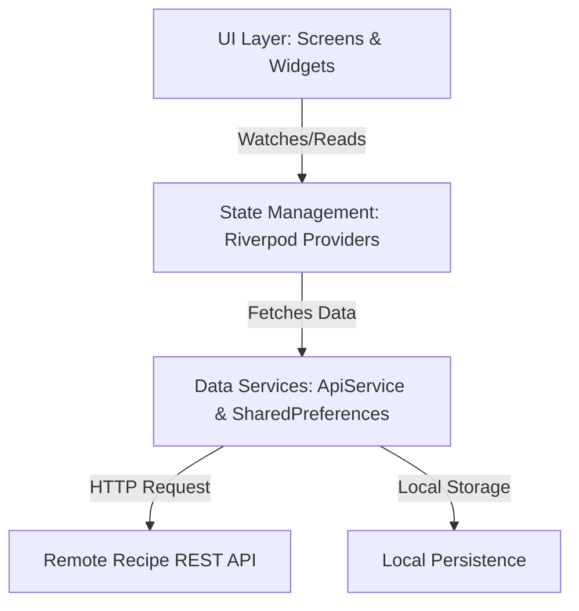

# Presentation Slide Deck: Recipe Finder Mobile Application

This presentation slide deck follows the requested Table of Contents and is tailored specifically to your **Recipe Finder** Flutter project.

---

## Slide 1: Title Slide

### **Recipe Finder: A Modern Cross-Platform Culinary Assistant**
* **Subtitle:** Discover, Cook, and Save Your Favorite Recipes with Ease
* **Presented by:** [Your Name / Team Name]
* **Technology Stack:** Flutter, Dart, Riverpod, Material 3, REST API

---

## Slide 2: Table of Contents

> [!NOTE]
> Overview of the presentation structure:

1. **Introduction**
2. **Literature Review**
3. **Methodology**
4. **Result**
5. **Discussion**
6. **Conclusion**

---

## Slide 3: 1. Introduction

### **Project Background & Problem Statement**
* **The Challenge:** In today's fast-paced world, individuals struggle to find quick, reliable, and diverse meal recipes tailored to their ingredients, dietary preferences, or cravings.
* **The Solution:** A cross-platform mobile application (**Recipe Finder**) that delivers a rich culinary database, seamless search, category filtering, and personalized favorites management.

### **Key Objectives**
* Provide an intuitive, modern Material 3 user interface.
* Enable rapid discovery of recipes across multiple categories.
* Offer offline-friendly favorites storage using persistent local state.
* Ensure cross-platform compatibility (Android & iOS) with high performance via Flutter.

---

## Slide 4: 2. Literature Review

### **Market Analysis & Existing Solutions**
* **Existing Apps:** Popular apps like Yummly, Tasty, and Allrecipes offer vast databases but can be bloated with ads or complex registration walls.
* **Gap Identified:** Need for a lightweight, fast, distraction-free recipe discovery app focused on core user needs: quick browsing, clear ingredients, step-by-step instructions, and instant bookmarking.

### **Technology Selection Rationale**
* **Flutter & Dart:** Chosen for single-codebase cross-platform deployment, expressive UI widgets, and 60/120fps rendering performance.
* **Flutter Riverpod:** Selected for robust, type-safe, compile-time safe state management, decoupling business logic from UI widgets.
* **Material 3:** Modern design guidelines ensuring accessibility, dynamic color schemes, and polished aesthetics.

---

## Slide 5: 3. Methodology

### **System Architecture & Design**

### **Core Modules & Implementation**
* **Data Layer (`data/`):**
  * `Meal` & `Category` models (`meal.dart`, `category.dart`).
  * `ApiService` for REST API communication.
  * `FavoritesRepository` for managing saved recipes.
* **State Management (`providers/`):**
  * `meals_provider.dart`, `categories_provider.dart`, `favorites_provider.dart` using Riverpod `StateNotifier` / `FutureProvider`.
* **UI Layer (`screens/`):**
  * Modular screens: Onboarding, Home, Explore, Favourites, and Meal Details.

---

## Slide 6: 4. Result

### **Application Features & User Interface**
1. **Onboarding Screen (`onboarding_screen.dart`):** Welcoming first-time users with introductory carousels and seamless state persistence (`SharedPreferences`).
2. **Home Screen (`home_screen.dart`):** Dynamic category selection, popular/trending recipes, and search bar integration.
3. **Explore Screen (`explore_screen.dart`):** Advanced filtering, category browsing, and recipe discovery.
4. **Meal Detail Screen (`meal_detail_screen.dart`):** Comprehensive view featuring high-res imagery, ingredients list, step-by-step cooking instructions, and favorite toggle.
5. **Favorites Screen (`favourites_screen.dart`):** Quick access to bookmarked recipes stored locally.

> [!TIP]
> *Add screenshots of your app here to visually showcase the polished Material 3 UI.*

---

## Slide 7: 5. Discussion

### **Key Achievements & Design Decisions**
* **Reactive State Management:** Riverpod allowed effortless synchronization between the Favorites screen and the Meal Detail screen without boilerplate callback hell.
* **Modular Codebase:** Clean separation of concerns between models, services, providers, and UI screens ensures high maintainability and testability.
* **Offline Resilience:** SharedPreferences integration ensures user preferences and onboarding state persist across app restarts.

### **Challenges & Solutions**
* **Challenge:** Handling asynchronous API loading states and error handling gracefully.
* **Solution:** Implemented robust AsyncValue handling in Riverpod to display loading shimmers, error states, and successful data rendering seamlessly.

---

## Slide 8: 6. Conclusion & Future Work

### **Conclusion**
* Successfully developed and delivered **Recipe Finder**, a fully functional, high-performance cross-platform recipe discovery application.
* Demonstrated the power of Flutter and Riverpod in building scalable, responsive mobile applications.

### **Future Enhancements**
* **Ingredient-Based Search:** Allow users to search recipes based on ingredients currently in their fridge.
* **User Authentication & Cloud Sync:** Integrate Firebase Auth and Firestore to sync favorites across multiple devices.
* **Meal Planning & Shopping Lists:** Add weekly meal planner calendars and automated grocery list generation.

---

## Slide 9: Q & A

### **Thank You!**
* **Questions & Answers**
* *Open for discussion*
